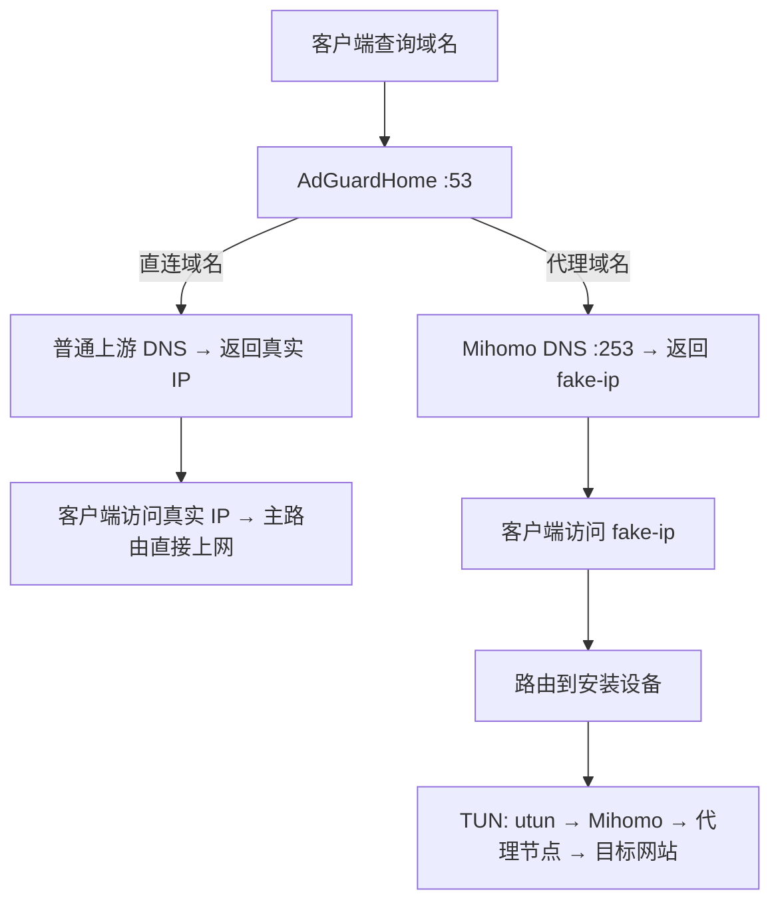

# MyRule

在 **OpenWrt** 或 **Debian/Ubuntu（systemd）** 上安装 AdGuardHome 和 Mihomo，提供 DNS 过滤与透明代理。默认安装目录为 `/etc/proxy`。

## 安装前准备

- 使用 root；安装器会检查所需工具和 CA 证书，列出缺失项并自动安装，然后重新检查。
- 准备节点订阅 URL、AdGuardHome 管理员用户名和密码的 **bcrypt 哈希**。
- 首次安装无法访问下载源时，准备一个 HTTP 或 SOCKS 代理地址。

依赖安装使用系统配置的软件源：Debian/Ubuntu 使用 `apt-get`，OpenWrt 使用 `opkg` 或 `apk`，只补齐缺失依赖。**软件包下载遵循包管理器自身的代理配置，不使用安装器的 `--proxy`**；失败时会显示错误和手动安装命令，并停止安装。启用定时更新时会按需补装 `crontab` 和防止任务重叠的 `flock`。

如果系统已有 `htpasswd`，可交互生成密码哈希：

```sh
htpasswd -nB -C 10 admin
```

按提示输入密码，复制输出中 `admin:` 后面的整段哈希；安装时填写哈希，登录时使用原密码。Debian/Ubuntu 可通过 `apt install apache2-utils` 安装此命令。

## 安装

### 交互安装

```sh
curl -fL -o /tmp/myrule-inst.sh https://raw.githubusercontent.com/AfxMsgBox/MyRule/main/sh/inst.sh
sh /tmp/myrule-inst.sh
```

无参数运行即进入向导，安装到 `/etc/proxy`。按提示填写代理、分支、订阅和管理员信息，并选择是否启动服务、设置自动更新。在线分支按编号选择，默认 `main`。

所有输入均可见，包括代理地址、订阅 URL 和密码哈希，支持直接粘贴后按回车；方括号内显示当前默认值，直接回车保留。

下载脚本本身也需要代理时，在上面的 curl 命令中添加 `--proxy 'socks5h://127.0.0.1:1080'`；运行安装器后仍需按提示填写代理。

上述下载命令需要已有 `curl`。也可以用浏览器下载 `sh/inst.sh`，复制到设备后运行 `sh /path/to/inst.sh`；脚本会自动补装缺失的 `curl`、`jq` 等依赖。

### 静默安装

有任意参数即进入静默模式，以下三个参数每次都必须提供；替换示例中的订阅和哈希：

```sh
sh /tmp/myrule-inst.sh \
  --subscribe-url 'https://example.com/subscription' \
  --agh-user admin \
  --agh-password '$2b$10$你的完整bcrypt哈希'
```

静默安装成功后自动启用服务，重装时重启服务；不会修改自动更新任务。支持 `--参数 值` 和 `--参数=值`，使用 `--help` 查看帮助。

| 参数 | 用途 / 默认值 |
|---|---|
| `--subscribe-url URL` | 必填，HTTP/HTTPS 节点订阅地址 |
| `--agh-user USER` | 必填，管理员用户名 |
| `--agh-password HASH` | 必填，bcrypt 哈希，用单引号包裹 |
| `--install-dir DIR` | 安装目录，默认 `/etc/proxy`；路径不要包含空格或中文 |
| `--source-dir DIR` | 本地仓库根目录，省略则从 GitHub 下载 |
| `--branch NAME` | GitHub 分支名，省略或为空使用 `main` |
| `--dns 'DNS1 DNS2'` | 默认 `223.5.5.5 119.29.29.29`；传 `--dns ''` 使用系统 DNS |
| `--proxy URL` | 外部后备代理，省略则不使用外部代理；已有 Core 代理仍会优先尝试 |

可在上面的命令末尾添加 `--branch dev --proxy 'socks5h://127.0.0.1:1080'` 等可选参数。静默模式不会沿用旧配置补齐参数；重装时不传 `--proxy` 会清空原外部代理。

### 从本地仓库安装

在 GitHub 仓库页面选择 **Code → Download ZIP**，将 ZIP 复制到设备。以 `main` 分支的 `MyRule-main.zip` 为例，在 ZIP 所在目录执行：

```sh
unzip MyRule-main.zip
cd MyRule-main
sh sh/inst.sh
```

下载其它分支时，替换 ZIP 文件名及解压后的目录名。解压需先有 `unzip`；缺少时，Debian/Ubuntu 执行 `apt-get update && apt-get install -y unzip`，OpenWrt 执行 `opkg update && opkg install unzip`（使用 apk 的系统执行 `apk update && apk add unzip`）。也可以在电脑上解压后，将整个目录复制到设备。

在向导中选择“本地仓库目录”，填写解压目录和**后续 GitHub 更新分支**。源目录与安装目录必须分开，安装目录不能放在源目录里面。

也可以静默安装：

```sh
sh /path/to/MyRule-main/sh/inst.sh \
  --source-dir /path/to/MyRule-main --branch main \
  --subscribe-url 'https://example.com/subscription' \
  --agh-user admin --agh-password '$2b$10$你的完整bcrypt哈希'
```

**本地安装仍需联网**下载程序、面板、订阅及外部规则，需要代理时添加 `--proxy`。以后更新从指定的 GitHub 分支获取仓库文件，本地源目录可在安装后删除。[完整下载清单](#下载列表)。

### 下载代理与重装

安装和更新的项目资源下载依次尝试：**已有 Core 代理 → 指定的外部代理 → 直连**。首次安装可指定外部代理；之后通常可使用运行中的 Core。外部代理支持 `http://`、`https://`、`socks5://`、`socks5h://`。系统依赖软件包使用包管理器自身的代理配置。

交互重装选择“不启动服务”时，新配置不会立即启用，但脚本和程序等文件可能已经更新。以后可重新运行安装器并选择启动，或按安装器打印的命令操作。

### 下载列表

除本仓库文件外，在线安装和本地安装都会获取以下资源，其中系统依赖仅在缺失时补装。项目资源的安装位置相对于安装目录（默认 `/etc/proxy`）；`<版本>` 为最新发行版本，`<架构>` 按设备 CPU 自动选择。

| 内容 / 用途 | 下载来源 | 下载文件或响应 | 安装位置 / 处理方式 |
|---|---|---|---|
| 缺失的系统依赖（工具、CA 证书；定时任务按需） | 设备配置的 Debian/Ubuntu 或 OpenWrt 软件源 | 软件包索引、缺失工具对应的软件包及其依赖 | 由 `apt-get` / `opkg` / `apk` 安装到系统目录；依赖齐全时不下载，具体包名见 [ARCH](ARCH.md#51-系统依赖自举) |
| 节点订阅（香港、日本、新加坡、台湾、美国） | 用户提供的 `--subscribe-url` / `MP_SUBSCRIBE_URL`，由 Core 模板追加地区筛选等查询参数 | 分别请求 5 份节点 YAML | `core/proxy/HongKong.yaml`、`Japan.yaml`、`Singapore.yaml`、`TaiWan.yaml`、`USA.yaml`（均在 `core/proxy/` 下） |
| Mihomo 最新版本信息 | `https://api.github.com/repos/MetaCubeX/mihomo/releases/latest` | Release JSON，读取 `tag_name` | 临时文件，用完删除 |
| Mihomo 代理内核 | `https://github.com/MetaCubeX/mihomo/releases/download/<版本>/mihomo-linux-<架构>-<版本>.gz` | `mihomo-linux-<架构>-<版本>.gz` | 解压为 `core/mihomo` |
| metacubexd Web 面板 | `https://github.com/MetaCubeX/metacubexd/releases/latest/download/compressed-dist.tgz` | `compressed-dist.tgz` | 解压到 Core 的 `external-ui` 指定目录，当前为 `core/ui/` |
| AdGuardHome 程序 | `https://github.com/AdguardTeam/AdGuardHome/releases/latest/download/AdGuardHome_linux_<架构>.tar.gz` | `AdGuardHome_linux_<架构>.tar.gz` | 提取程序到 `agh/AdGuardHome` |
| AdAway Default Blocklist | `https://adguardteam.github.io/HostlistsRegistry/assets/filter_2.txt` | `filter_2.txt` | `agh/data/filters/1733109081.txt` |
| AdGuard DNS filter | `https://adguardteam.github.io/HostlistsRegistry/assets/filter_1.txt` | `filter_1.txt` | `agh/data/filters/1733109082.txt` |
| WindowsSpyBlocker - Hosts spy rules | `https://adguardteam.github.io/HostlistsRegistry/assets/filter_23.txt` | `filter_23.txt` | `agh/data/filters/1733109083.txt` |
| CHN: anti-AD | `https://adguardteam.github.io/HostlistsRegistry/assets/filter_21.txt` | `filter_21.txt` | `agh/data/filters/1733109085.txt` |
| 非中国顶级域名列表 | `https://raw.githubusercontent.com/Loyalsoldier/clash-rules/release/tld-not-cn.txt` | `tld-not-cn.txt` | 保存为 `agh/download/notcn.txt`，转换为 AGH 上游规则时剔除 `.bj` |
| GFW 域名列表 | `https://raw.githubusercontent.com/Loyalsoldier/clash-rules/release/gfw.txt` | Clash payload 格式的 `gfw.txt` | 保存为 `agh/download/gfwlist.txt`，转换为 AGH 上游规则 |

## 安装后使用

当前默认配置的访问地址如下；修改过端口时以实际配置为准：

| 用途 | 地址 |
|---|---|
| AdGuardHome 管理页面 | `http://设备IP:180`，使用安装时设置的用户名和原密码登录 |
| Mihomo 面板 | `http://设备IP:3721/ui/` |
| DNS 服务 | `设备IP:53` |

### 数据面：DNS → fake-ip → TUN

客户端先向 AdGuardHome 查询域名：直连域名返回真实 IP，代理域名交给 Mihomo DNS，返回 `198.18.0.0/16` 网段中的 fake-ip（虚拟地址）。随后访问这个虚拟地址的流量，需要经路由送到安装设备的 TUN 接口，才能由 Mihomo 通过代理节点访问目标网站。



**DNS 和路由都要配置：只修改 DNS，客户端可能拿到 fake-ip，却无法访问。**

### 路由器需要配置什么

以下示例假设主路由为 `192.168.1.1`，独立安装设备为同一 LAN 内的 `192.168.1.2`；请替换成实际地址，并为安装设备固定 IP。

| 配置项 | 安装在主路由上 | 安装在独立设备上（旁路设备 / LXC 等） |
|---|---|---|
| 主路由 LAN / DHCP 下发的 DNS | `192.168.1.1`，即本机 AGH | `192.168.1.2`，即安装设备的 AGH |
| 客户端默认网关 | 保持主路由 `192.168.1.1` | 保持主路由 `192.168.1.1` |
| 主路由上的 fake-ip 路由 | 脚本负责将本机 fake-ip 网段指向 `utun` | 手工添加静态路由：目标 `198.18.0.0/16`，下一跳 `192.168.1.2`，接口选 LAN |
| 安装设备上的 fake-ip 路由 | 脚本自动维护 | 脚本自动维护 `198.18.0.0/16 → utun`；设备自身仍经主路由上网 |

路由器页面若分开填写目标和掩码，分别使用 `198.18.0.0` 和 `255.255.0.0`。修改 DHCP 后，让客户端重新连接网络或续租；这里设置的是**下发给客户端的 DNS**，不是路由器的 WAN 上游 DNS。

- **DNS 入口**：客户端应使用 AGH；额外的公共 DNS 或浏览器自带的外部安全 DNS 可能绕过分流。
- **端口冲突**：安装设备的 TCP/UDP 53 端口需供 AGH 使用。若已有 dnsmasq 等 DNS 服务占用，应调整其 DNS 监听；保留需要的 DHCP 服务。
- **转发放行**：防火墙需允许客户端访问 AGH 的 TCP/UDP 53，以及 fake-ip 流量沿上述路径转发。安装器会开启 IPv4 转发；LXC 等环境提示无法开启时，需要在宿主机处理。详细要求见 [ARCH 的路由说明](ARCH.md#8-fake-ip-与路由)。

安装器不会自动修改主路由的 DHCP、上述手工静态路由或防火墙规则。网段和接口以当前 Core 配置为准；修改 fake-ip 网段后，也要同步调整主路由静态路由。

## 更新与查看日志

以下命令按 `/etc/proxy` 安装目录编写；安装在其它位置时替换路径。

| 操作 | 命令 |
|---|---|
| 更新脚本 | `sh /etc/proxy/sh/update-scripts.sh` |
| 更新配置、订阅和规则并重启服务 | `sh /etc/proxy/sh/update-all-configs-restart-services.sh` |
| 下载最新版 Mihomo、AdGuardHome 和面板 | `sh /etc/proxy/sh/update-bin.sh` |
| 查看 OpenWrt 日志 | `logread -e MyProxy -f` |
| 查看 Debian/Ubuntu 日志 | `journalctl -t MyProxy -f` |

升级程序后需要重启服务才能生效：

```sh
# Debian/Ubuntu
systemctl restart proxy_core agh

# OpenWrt
/etc/init.d/proxy_core restart && /etc/init.d/agh restart
```

仅在更新成功后执行重启。查看服务状态可用 `systemctl status proxy_core agh`（Debian/Ubuntu），或分别运行 `/etc/init.d/proxy_core status`、`/etc/init.d/agh status`（OpenWrt）。

交互安装只需分别填写“每隔几天更新脚本”和“每隔几天更新配置”，回车默认 3 天，支持 1–365 天；输入 `n` 跳过设置，已有任务保留。脚本每天 03:00、配置每天 03:05 检查是否到期，按连续天数计算，跨月不重置；失败后次日重试。配置更新成功后自动重启服务。用 `crontab -l` 查看任务，重新运行交互安装可调整间隔。静默安装不修改这些设置。

## 修改配置

### env.local.conf

本机参数保存在 `/etc/proxy/sh/env.local.conf`，安装器自动生成；需要时可手动编辑。字符串使用单引号包裹，不要把含订阅或密码的文件上传到仓库。

| 变量 | 用途 |
|---|---|
| `MP_SUBSCRIBE_URL` | 节点订阅 URL |
| `MP_AGH_USER_NAME` | 管理员用户名 |
| `MP_AGH_PASSWORD` | 管理员密码的 bcrypt 哈希 |
| `MP_REPO_BRANCH` | 后续更新分支，默认 `main` |
| `MP_PROXY` | 外部后备代理，空值表示不使用 |
| `MP_LOCAL_DNS` | 上游 DNS，多个地址以空格分隔；空值使用系统 DNS |
| `MP_INST_DIR` | 安装目录，由安装器写入，不要通过改此值迁移安装 |

修改后运行配置更新命令使其生效：

```sh
sh /etc/proxy/sh/update-all-configs-restart-services.sh
```

分流域名在仓库 `domain/*.txt` 中维护，提交到所用分支后再更新。**完整配置更新会覆盖在 AdGuardHome 页面中修改的配置**；需要长期保留的修改应维护到仓库模板中。

## 卸载

```sh
# 移除服务和安装器创建的自动更新任务，保留文件与数据
sh /etc/proxy/sh/uninstall.sh

# 同时删除安装目录中的 sh/、core/、agh/，包括配置和运行数据
sh /etc/proxy/sh/uninstall.sh --purge
```

默认询问确认，回车取消。安装在其它目录时，必须显式指定绝对路径：

```sh
sh /opt/myproxy/sh/uninstall.sh --install-dir /opt/myproxy --purge
```

自动化执行可加 `--yes` 跳过询问。卸载保留 IPv4 转发设置和手工添加的定时任务；不要与安装或更新同时运行。

实现细节和高级维护操作见 [ARCH.md](ARCH.md)，未完成事项见 [TODO.md](TODO.md)。
