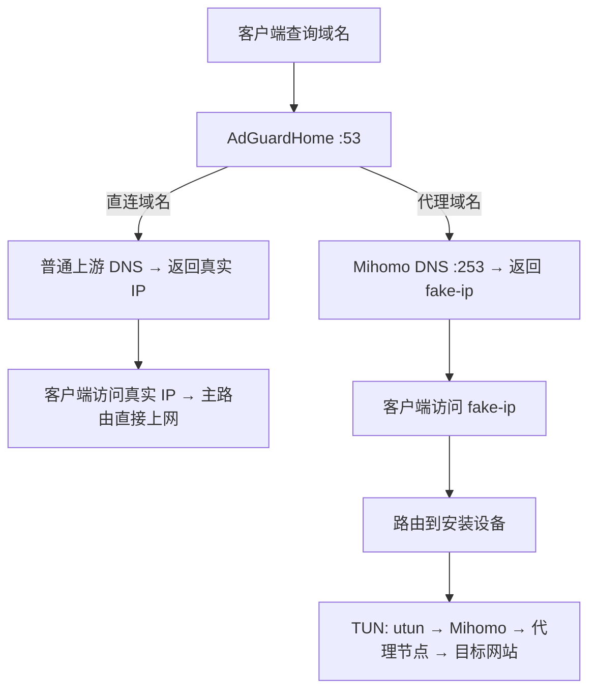

# MyRule

在 **OpenWrt** 或 **Debian/Ubuntu（systemd）** 上安装 AdGuardHome 和 Mihomo，提供 DNS 过滤与透明代理。默认安装目录为 `/etc/proxy`。

## 安装前准备

- 安装目标为 OpenWrt 或使用 systemd 的 Linux；目标机需能访问自己的软件源。
- 可以从 Linux、macOS、OpenWrt 发起安装；macOS 仅用于下载资源和通过 SSH 部署到目标机。SSH 登录使用 root，或拥有 sudo 权限的用户；本机安装使用 root。安装器会提示并补装缺失依赖。
- 准备节点订阅 URL。安装时选择是否设置 AdGuardHome 登录密码；用户名默认 `admin`，设置密码时填写 **bcrypt 哈希**。
- 首次安装无法访问下载源时，准备一个 HTTP 或 SOCKS 代理地址。
- LXC 等容器需先在宿主机开放并挂载 `/dev/net/tun`。安装器会检查设备，并在启动时检查 Core API、TUN 接口和 fake-ip 路由；缺失时提示原因并停止。

依赖安装使用系统配置的软件源：Debian/Ubuntu 使用 `apt-get`，OpenWrt 使用 `opkg` 或 `apk`，只补齐缺失依赖。macOS 发起端缺少工具时使用已安装的 Homebrew；没有 Homebrew 时提示手动补齐。SSH 发起端需要 OpenSSH 客户端（OpenWrt 可安装 `openssh-client`）。**软件包下载遵循包管理器自身的代理配置，不使用安装器的 `--proxy`**；失败时会显示错误和手动安装命令，并停止安装。启用定时更新时会按需补装 `crontab` 和防止任务重叠的 `flock`。

如果选择设置密码，可用已有的 `htpasswd` 生成哈希（安装器不自动安装密码生成工具）：

```sh
htpasswd -nB -C 10 admin
```

按提示输入密码，复制输出中 `admin:` 后面的整段哈希；安装时填写哈希，登录时使用原密码。Debian/Ubuntu 可通过 `apt install apache2-utils` 安装此命令。

## 安装

### 交互安装

```sh
curl -fL -o /tmp/myrule-inst.sh https://raw.githubusercontent.com/AfxMsgBox/MyRule/main/sh/inst.sh
sh /tmp/myrule-inst.sh
```

无参数运行即进入向导。单独下载的 `inst.sh` 会先询问下载代理、列出 GitHub 分支，按选择的分支获取安装模块；随后选择本机或 SSH 安装、在线或本地仓库来源，再填写订阅等信息，并选择是否设置 AGH 登录密码。选择设置时填写用户名（默认 `admin`）和 bcrypt 哈希；选择不设置时免登录，能访问管理端口的人均可修改配置。可选择是否启动服务，以及每隔几天自动更新。默认目录 `/etc/proxy`；所有交互安装均从 GitHub 获取分支列表，按编号选择，默认 `main`。

如果使用开发分支，先将下载命令 URL 中的 `main` 替换为对应分支名，启动后选择包含新版安装器的分支。下载后的文件无法自动识别自己的来源分支；也可用 `sh inst.sh --interactive --branch 分支名` 预设分支列表的默认选项。启动时已选过分支，后续向导不会重复询问。

安装配置输入均可见，包括代理地址、订阅 URL 和密码哈希（SSH/sudo 密码使用系统提示），支持直接粘贴后按回车；方括号内显示当前默认值，直接回车保留。

调试时可保存每一步的输入，下次自动用作默认值：

```sh
sh inst.sh --fill-from
sh inst.sh --fill-from ./debug.cfg --log-file ./debug.log
```

`--fill-from` 自动进入交互模式；省略文件路径时使用 **inst.sh 同目录的 `myrule.inst.cfg`**。文件不存在时自动创建，每次输入后立即保存；已有字段优先作为默认值，缺少的字段沿用原默认值。分支保存名称，列表顺序变化不影响选择。不带此参数则不读取、不保存交互配置。配置为 JSON，可能包含订阅地址、代理凭据和密码哈希，请勿提交或分享；SSH/sudo 密码不保存。

下载脚本本身也需要代理时，在上面的 curl 命令中添加 `--proxy 'socks5h://127.0.0.1:1080'`；运行安装器后仍需按提示填写代理。

上述下载命令需要已有 `curl`。也可以用浏览器下载 `sh/inst.sh`，复制到设备后运行 `sh /path/to/inst.sh`；脚本会自动补装缺失的 `curl`、`jq` 等依赖。

查看帮助：`sh inst.sh --help`（也支持 `-h` 或 `help`），无需联网。未知参数、重复参数或参数缺少值会在下载前报错；读取交互配置的参数是 `--fill-from [PATH]`。

### 静默安装

有参数默认进入命令行模式（加 `--interactive` 或 `--fill-from` 可继续使用向导）。订阅必填；认证必须明确选择 `--agh-password HASH` 或 `--no-auth`，用户名默认 `admin`：

```sh
sh /tmp/myrule-inst.sh \
  --subscribe-url 'https://example.com/subscription' \
  --agh-user admin \
  --agh-password '$2b$10$你的完整bcrypt哈希'
```

不设置密码时，将示例中的 `--agh-user` 和 `--agh-password` 两项替换为 `--no-auth`。

静默安装成功后自动启用服务，重装时重启服务；未指定更新间隔时保留原自动更新任务。支持 `--参数 值` 和 `--参数=值`，使用 `--help` 查看帮助。

| 参数 | 用途 / 默认值 |
|---|---|
| `--subscribe-url URL` | 必填，HTTP/HTTPS 节点订阅地址 |
| `--agh-user USER` | 管理员用户名，默认 `admin` |
| `--agh-password HASH` | 设置登录密码，填写 bcrypt 哈希并用单引号包裹；与 `--no-auth` 二选一 |
| `--no-auth` | 关闭 AGH 登录认证，无需用户名和密码即可进入管理页面 |
| `--install-dir DIR` | 安装目录，默认 `/etc/proxy`；路径不要包含空格或中文 |
| `--local` | 自动使用 inst.sh 所在的本地仓库（含未提交修改） |
| `--source-dir DIR` | 显式指定本地仓库根目录 |
| `--target USER@HOST` | SSH 目标；省略则安装到本机 |
| `--ssh-port PORT` / `--ssh-key FILE` | SSH 端口（默认 22）/ 私钥路径 |
| `--ssh-auth auto\|password\|key` | 认证方式；默认 auto，使用默认密钥、agent 或密码提示 |
| `--branch NAME` | GitHub 分支名，省略或为空使用 `main` |
| `--dns 'DNS1 DNS2'` | 默认 `223.5.5.5 119.29.29.29`；传 `--dns ''` 使用系统 DNS |
| `--proxy URL` | 保存到目标机的外部后备代理，默认空；Core 仍优先 |
| `--download-proxy URL` | 发起端本次下载代理，不保存到目标机 |
| `--scripts-days N` / `--configs-days N` | 脚本 / 配置更新间隔，1–365 天；省略保留已有任务 |
| `--no-start` | 暂不启用新配置及启动服务 |
| `--fill-from [PATH]` | 读取并保存交互默认值；省略路径使用 inst.sh 同目录的 `myrule.inst.cfg` |
| `--log-file PATH` | 指定安装日志；默认 inst.sh 同目录的 `myrule.inst.log` |

可在上面的命令末尾添加 `--branch dev --proxy 'socks5h://127.0.0.1:1080'` 等可选参数。静默模式不会沿用旧配置补齐参数；重装时不传 `--proxy` 会清空原外部代理。

### 从本地仓库安装

在 GitHub 仓库页面选择 **Code → Download ZIP**，将 ZIP 复制到设备。以 `main` 分支的 `MyRule-main.zip` 为例，在 ZIP 所在目录执行：

```sh
unzip MyRule-main.zip
cd MyRule-main
sh sh/inst.sh
```

下载其它分支时，替换 ZIP 文件名及解压后的目录名。解压需先有 `unzip`；缺少时，Debian/Ubuntu 执行 `apt-get update && apt-get install -y unzip`，OpenWrt 执行 `opkg update && opkg install unzip`（使用 apk 的系统执行 `apk update && apk add unzip`）。也可以在电脑上解压后，将整个目录复制到设备。

在向导中选择“本机安装（使用本地仓库）”，仓库根目录自动按 inst.sh 的真实位置识别，从 GitHub 列表选择**后续更新分支**。源目录与安装目录必须分开，安装目录不能放在源目录里面。

也可以静默安装：

```sh
sh /path/to/MyRule-main/sh/inst.sh \
  --local --branch main \
  --subscribe-url 'https://example.com/subscription' \
  --agh-user admin --agh-password '$2b$10$你的完整bcrypt哈希'
```

**本地安装仍需联网**下载程序、面板、订阅及外部规则，需要代理时添加 `--proxy`。以后更新从指定的 GitHub 分支获取仓库文件，本地源目录可在安装后删除。[完整下载清单](#下载列表)。

### 通过 SSH 安装

目标机无法访问 GitHub 时，在能访问下载源的 Linux、macOS 或 OpenWrt 设备上运行安装器。所有仓库文件、程序、订阅和规则先下载到发起端，再上传安装；目标机只需能访问自己的软件源来补装系统依赖。

**本机在线安装和 SSH 在线安装都只需先下载一个 `inst.sh`**（使用上面的 curl 命令或浏览器）；其余安装代码和资源由脚本自动获取，不需要手工下载辅助脚本。

```sh
# 使用 GitHub 分支文件
sh /tmp/myrule-inst.sh --target root@192.168.1.2 --branch main \
  --subscribe-url 'https://example.com/subscription' \
  --agh-user admin --agh-password '$2b$10$你的完整bcrypt哈希'

# 开发调试：使用 inst.sh 所在仓库，包括未提交的修改
sh /path/to/MyRule/sh/inst.sh --local --target admin@192.168.1.2 \
  --ssh-key "$HOME/.ssh/id_ed25519" --branch main \
  --subscribe-url 'https://example.com/subscription' \
  --agh-user admin --agh-password '$2b$10$你的完整bcrypt哈希'
```

也可直接无参数运行，在向导中选择 SSH 安装。用户名放在 `--target` 中；密码认证使用 `--ssh-auth password`，由 SSH 提示输入。首次连接按 SSH 提示核对主机指纹；非 root 用户安装时可能需要输入 sudo 密码。全自动运行需提前配置密钥、已知主机及免密码 sudo（或 root 登录）。

下载的是**目标机架构**的程序，因此可以从 Mac 或不同 CPU 架构的开发机安装。安装后更新从指定 GitHub 分支下载，不再依赖发起端或原本地仓库。

结束时会明确显示安装结果：启用服务后显示“安装成功”；选择不启动则显示“文件部署成功”，不代表服务已运行。SSH 模式在远程正常退出后显示“SSH 安装成功”和“SSH 会话已正常结束”；失败或连接异常会显示失败原因。维护命令需要在目标机执行。

### 下载代理与重装

下载顺序为：**下载所在机器的 Core 代理 → 外部后备代理 → 直连**。

所有项目资源下载均显示已下载大小、平均速度和耗时；服务器提供总大小时显示百分比，否则显示已下载字节数。终端每秒刷新，重定向或通过 `tee` 保存日志时定期输出进度；SSH 目标机读取已下载的安装包时显示“读取安装包”，不重复下载。临时网络错误最多自动重试两轮，持续 30 秒无数据会中止当前请求并尝试回退；必需资源最终失败时停止安装。软件包管理器使用自己的进度显示。

下载命令只写日志，终端保留阶段、进度和结果。默认日志是 **inst.sh 同目录的 `myrule.inst.log`**，每次启动安装覆盖上次记录，同次安装的各阶段及远端日志连续写入；也可通过 `--log-file PATH` 指定。日志包含时间、系统与工具版本、路径解析、下载命令与进度、代理通道、HTTP 状态、重试和退出码，以及服务启停命令的脱敏输出；SSH 部署结束后会取回目标机日志并合并，连接异常时提示取回失败。出现问题可发送这份日志。

日志中的订阅等自定义 URL 路径、查询参数、代理账号密码和认证头会替换为 `<redacted>`，已知公开下载地址保留路径。软件包补装和 Core API 刷新命令也写入日志；API 不提供字节进度。日志与交互配置仅当前用户可读写，父目录须已存在，两者不能使用同一个文件。默认文件已被 Git 忽略，自定义文件名请自行排除。日志仍可能包含本地路径和目标机地址，分享前可按需遮盖。

| 场景 | 外部代理参数 |
|---|---|
| 本机安装 | `--proxy`；可用 `--download-proxy` 单独覆盖本次下载代理 |
| SSH 安装，在发起端下载 | `--download-proxy`；不会使用目标机的代理地址 |
| 目标机以后的更新 | 保存的 `--proxy`；省略为空，通常使用已启动的本机 Core |

例如从开发机部署时，添加 `--download-proxy 'socks5h://127.0.0.1:1080'`，不会把开发机的代理地址写入目标机。外部代理支持 HTTP、HTTPS、SOCKS5、SOCKS5H。系统依赖使用包管理器自身的代理配置。

三种方式都覆盖安装器管理的脚本、程序、面板和生成的配置及规则，保留运行数据、原卸载恢复记录和未调整的定时任务。先完成下载及校验，再安装并切换服务。选择“不启动服务”或 `--no-start` 时，重装保留原正式配置，新配置暂存为 `.pending`；脚本和程序等文件仍会更新。

### 下载列表

除本仓库文件外，安装还需要以下资源。SSH 模式的项目资源全部在发起端下载、上传，系统依赖则在各自机器缺失时从软件源补装。项目资源的安装位置相对于安装目录（默认 `/etc/proxy`）；`<版本>` 为最新发行版本，`<架构>` 按设备 CPU 自动选择。

| 内容 / 用途 | 下载来源 | 下载文件或响应 | 安装位置 / 处理方式 |
|---|---|---|---|
| 缺失的系统依赖（工具、CA 证书；定时任务按需） | 设备配置的 Debian/Ubuntu 或 OpenWrt 软件源 | 软件包索引、缺失工具对应的软件包及其依赖 | 由 `apt-get` / `opkg` / `apk` 安装到系统目录；依赖齐全时不下载，具体包名见 [ARCH](ARCH.md#51-系统依赖自举) |
| 节点订阅（香港、日本、新加坡、台湾、美国） | 用户提供的 `--subscribe-url` / `MP_SUBSCRIBE_URL`，由 Core 模板追加地区筛选等查询参数 | 分别请求 5 份节点 YAML | `core/proxy/HongKong.yaml`、`Japan.yaml`、`Singapore.yaml`、`TaiWan.yaml`、`USA.yaml`（均在 `core/proxy/` 下） |
| Mihomo 最新版本信息 | `https://api.github.com/repos/MetaCubeX/mihomo/releases/latest` | Release JSON，读取 `tag_name` | 临时文件，用完删除 |
| Mihomo 代理内核 | `https://github.com/MetaCubeX/mihomo/releases/download/<版本>/mihomo-linux-<架构>-<版本>.gz` | `mihomo-linux-<架构>-<版本>.gz`；x86_64 使用 `amd64-compatible` 兼容版 | 解压为 `core/mihomo` |
| metacubexd Web 面板 | `https://github.com/MetaCubeX/metacubexd/releases/latest/download/compressed-dist.tgz` | `compressed-dist.tgz` | 解压到 Core 的 `external-ui` 指定目录，当前为 `core/ui/` |
| AdGuardHome 程序 | `https://github.com/AdguardTeam/AdGuardHome/releases/latest/download/AdGuardHome_linux_<架构>.tar.gz` | `AdGuardHome_linux_<架构>.tar.gz` | 提取程序到 `agh/AdGuardHome` |
| AdAway Default Blocklist | `https://adguardteam.github.io/HostlistsRegistry/assets/filter_2.txt` | `filter_2.txt` | `agh/data/filters/1733109081.txt` |
| AdGuard DNS filter | `https://adguardteam.github.io/HostlistsRegistry/assets/filter_1.txt` | `filter_1.txt` | `agh/data/filters/1733109082.txt` |
| WindowsSpyBlocker - Hosts spy rules | `https://adguardteam.github.io/HostlistsRegistry/assets/filter_23.txt` | `filter_23.txt` | `agh/data/filters/1733109083.txt` |
| CHN: anti-AD | `https://adguardteam.github.io/HostlistsRegistry/assets/filter_21.txt` | `filter_21.txt` | `agh/data/filters/1733109085.txt` |
| 非中国顶级域名列表 | `https://raw.githubusercontent.com/Loyalsoldier/clash-rules/release/tld-not-cn.txt` | `tld-not-cn.txt` | 保存为 `agh/download/notcn.txt`，转换为 AGH 上游规则时剔除 `.bj` |
| GFW 域名列表 | `https://raw.githubusercontent.com/Loyalsoldier/clash-rules/release/gfw.txt` | Clash payload 格式的 `gfw.txt` | 保存为 `agh/download/gfwlist.txt`，转换为 AGH 上游规则 |

## 安装后使用

当前默认配置的访问地址如下；修改过端口时以实际配置为准：

| 用途 | 地址 |
|---|---|
| AdGuardHome 管理页面 | `http://设备IP:180`，使用设置的用户名和原密码登录；未设置密码则直接进入 |
| Mihomo 面板 | `http://设备IP:3721/ui/` |
| DNS 服务 | `设备IP:53` |

### 数据面：DNS → fake-ip → TUN

客户端先向 AdGuardHome 查询域名：直连域名返回真实 IP，代理域名交给 Mihomo DNS，返回 `198.18.0.0/16` 网段中的 fake-ip（虚拟地址）。随后访问这个虚拟地址的流量，需要经路由送到安装设备的 TUN 接口，才能由 Mihomo 通过代理节点访问目标网站。



**DNS 和路由都要配置：只修改 DNS，客户端可能拿到 fake-ip，却无法访问。**

### 路由器需要配置什么

以下示例假设主路由为 `192.168.1.1`，独立安装设备为同一 LAN 内的 `192.168.1.2`；请替换成实际地址，并为安装设备固定 IP。

| 配置项 | 安装在主路由上 | 安装在独立设备上（旁路设备 / LXC 等） |
|---|---|---|
| 主路由 LAN / DHCP 下发的 DNS | `192.168.1.1`，即本机 AGH | `192.168.1.2`，即安装设备的 AGH |
| 客户端默认网关 | 保持主路由 `192.168.1.1` | 保持主路由 `192.168.1.1` |
| 主路由上的 fake-ip 路由 | 脚本负责将本机 fake-ip 网段指向 `utun` | 手工添加静态路由：目标 `198.18.0.0/16`，下一跳 `192.168.1.2`，接口选 LAN |
| 安装设备上的 fake-ip 路由 | 脚本自动维护 | 脚本自动维护 `198.18.0.0/16 → utun`；设备自身仍经主路由上网 |

路由器页面若分开填写目标和掩码，分别使用 `198.18.0.0` 和 `255.255.0.0`。修改 DHCP 后，让客户端重新连接网络或续租；这里设置的是**下发给客户端的 DNS**，不是路由器的 WAN 上游 DNS。

- **DNS 入口**：客户端应使用 AGH；额外的公共 DNS 或浏览器自带的外部安全 DNS 可能绕过分流。
- **端口冲突**：安装设备的 TCP/UDP 53 端口需供 AGH 使用。若已有 dnsmasq 等 DNS 服务占用，应调整其 DNS 监听；保留需要的 DHCP 服务。
- **转发放行**：防火墙需允许客户端访问 AGH 的 TCP/UDP 53，以及 fake-ip 流量沿上述路径转发。安装器会开启 IPv4 转发；LXC 等环境提示无法开启时，需要在宿主机处理。详细要求见 [ARCH 的路由说明](ARCH.md#8-fake-ip-与路由)。

安装器不会自动修改主路由的 DHCP、上述手工静态路由或防火墙规则。网段和接口以当前 Core 配置为准；修改 fake-ip 网段后，也要同步调整主路由静态路由。

## 更新与查看日志

以下命令按 `/etc/proxy` 安装目录编写；安装在其它位置时替换路径。

| 操作 | 命令 |
|---|---|
| 更新脚本 | `sh /etc/proxy/sh/update-scripts.sh` |
| 更新配置、订阅和规则并重启服务 | `sh /etc/proxy/sh/update-all-configs-restart-services.sh` |
| 下载最新版 Mihomo、AdGuardHome 和面板 | `sh /etc/proxy/sh/update-bin.sh` |
| 查看 OpenWrt 日志 | `logread -e MyProxy -f` |
| 查看 Debian/Ubuntu 日志 | `journalctl -t MyProxy -f` |

安装和更新脚本时会自动设置脚本执行权限；设置失败会报错退出。

升级程序后需要重启服务才能生效：

```sh
# Debian/Ubuntu
systemctl restart proxy_core agh

# OpenWrt
/etc/init.d/proxy_core restart && /etc/init.d/agh restart
```

仅在更新成功后执行重启。查看服务状态可用 `systemctl status proxy_core agh`（Debian/Ubuntu），或分别运行 `/etc/init.d/proxy_core status`、`/etc/init.d/agh status`（OpenWrt）。

交互安装只需分别填写“每隔几天更新脚本”和“每隔几天更新配置”，回车默认 3 天，支持 1–365 天；输入 `n` 跳过设置，已有任务保留。脚本每天 03:00、配置每天 03:05 检查是否到期，按连续天数计算，跨月不重置；失败后次日重试。配置更新成功后自动重启服务。用 `crontab -l` 查看任务，重新运行交互安装可调整间隔。命令行安装可用 `--scripts-days` / `--configs-days` 设置间隔；省略则保留原设置。

## 修改配置

### env.local.conf

本机参数保存在 `/etc/proxy/sh/env.local.conf`，安装器自动生成；需要时可手动编辑。字符串使用单引号包裹，不要把含订阅或密码的文件上传到仓库。

| 变量 | 用途 |
|---|---|
| `MP_SUBSCRIBE_URL` | 节点订阅 URL |
| `MP_AGH_USER_NAME` | 管理员用户名，默认 `admin`；免登录时不启用账号 |
| `MP_AGH_PASSWORD` | 管理员密码的 bcrypt 哈希；空值表示免登录，后续更新沿用 |
| `MP_REPO_BRANCH` | 后续更新分支，默认 `main` |
| `MP_PROXY` | 外部后备代理，空值表示不使用 |
| `MP_LOCAL_DNS` | 上游 DNS，多个地址以空格分隔；空值使用系统 DNS |
| `MP_INST_DIR` | 安装目录，由安装器写入，不要通过改此值迁移安装 |

修改后运行配置更新命令使其生效：

```sh
sh /etc/proxy/sh/update-all-configs-restart-services.sh
```

分流域名在仓库 `domain/*.txt` 中维护，提交到所用分支后再更新。**完整配置更新会覆盖在 AdGuardHome 页面中修改的配置**；需要长期保留的修改应维护到仓库模板中。

## 卸载

停止服务后最多等待 10 秒让进程退出；超时会报错并保留服务文件和数据，避免删除仍在使用的程序。

```sh
# 交互卸载：询问是否删除安装文件，回车默认保留
sh /etc/proxy/sh/uninstall.sh

# 删除 sh/、core/、agh/（含配置和运行数据），并删除清理后已空的安装目录
sh /etc/proxy/sh/uninstall.sh --purge
```

无参数时先询问是否删除程序、配置及运行数据，再显示卸载范围并确认执行；最后确认时回车取消。带参数时由 `--purge` 决定是否删除文件，省略则保留。安装在其它目录时，必须显式指定绝对路径：

```sh
sh /opt/myproxy/sh/uninstall.sh --install-dir /opt/myproxy --purge
```

选择删除时，清理后已空的安装目录也会删除；若目录内仍有其它文件，则保留目录并提示。

自动化执行可加 `--yes` 跳过询问。卸载清理安装器创建的 Core/AGH 服务、自启动链接、hotplug 路由修复脚本及自动更新任务；本项目记录的残留 fake-ip 路由也会清理。

新安装会保存 IPv4 转发设置的原值，卸载时恢复。旧安装缺少记录时保留并提示；转发配置在安装后被另外修改时，脚本会停止并提示核对，避免覆盖后续设置。

**卸载不操作 apk、opkg、apt 或任何已安装软件包，也不停止系统 cron 服务。** 手工配置的其它任务、主路由静态路由和防火墙规则保留。不要与安装或更新同时运行。

实现细节和高级维护操作见 [ARCH.md](ARCH.md)，未完成事项见 [TODO.md](TODO.md)。
